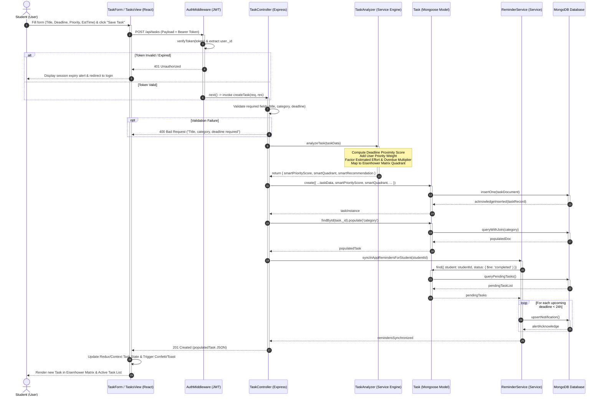
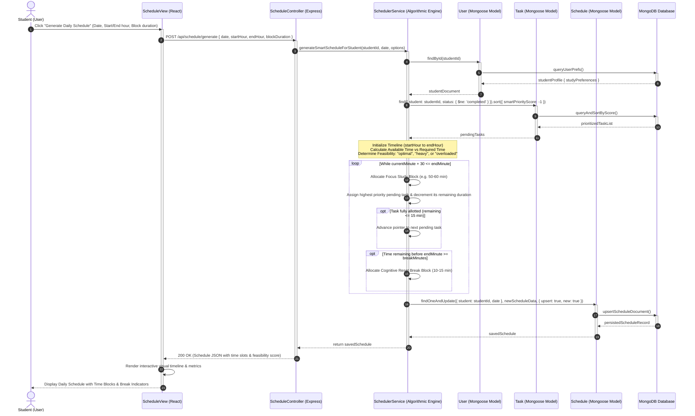
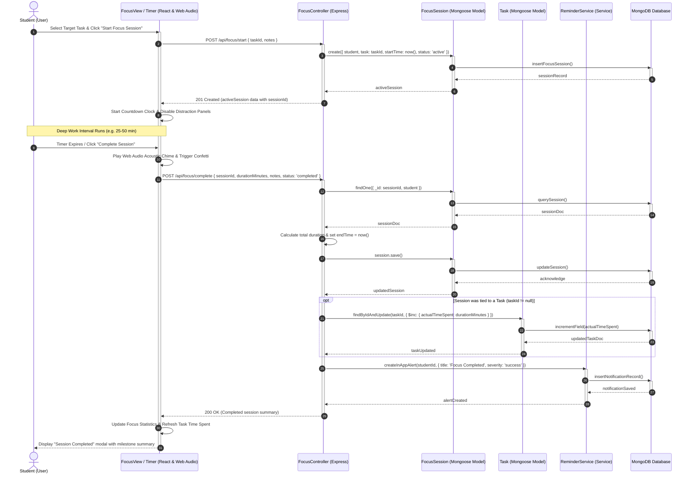
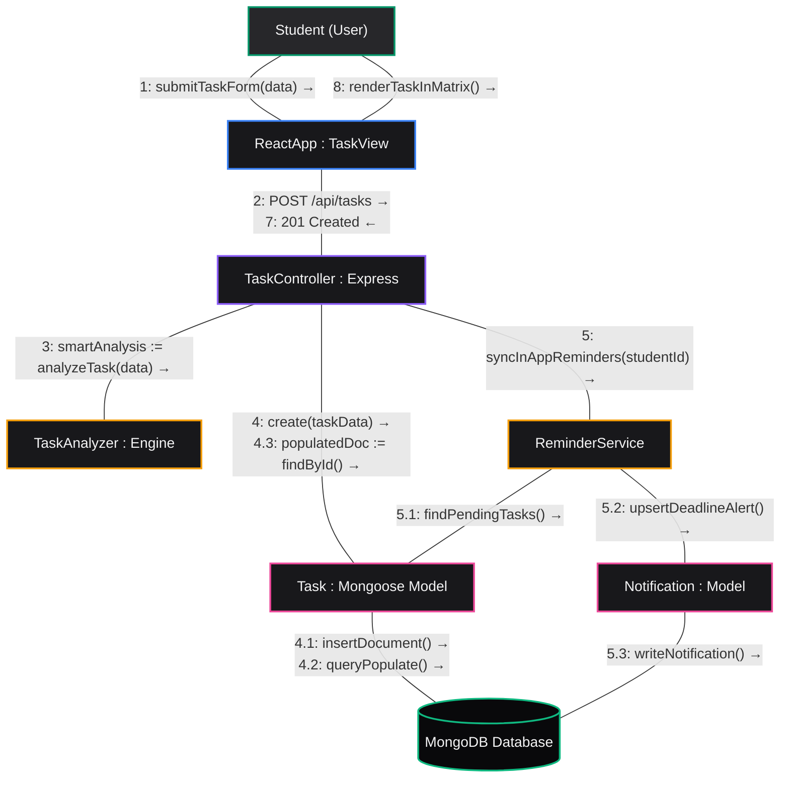
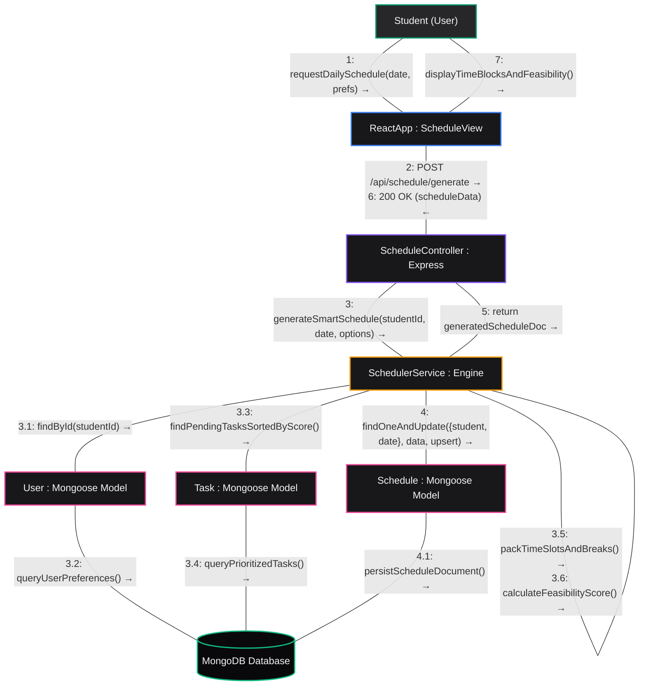
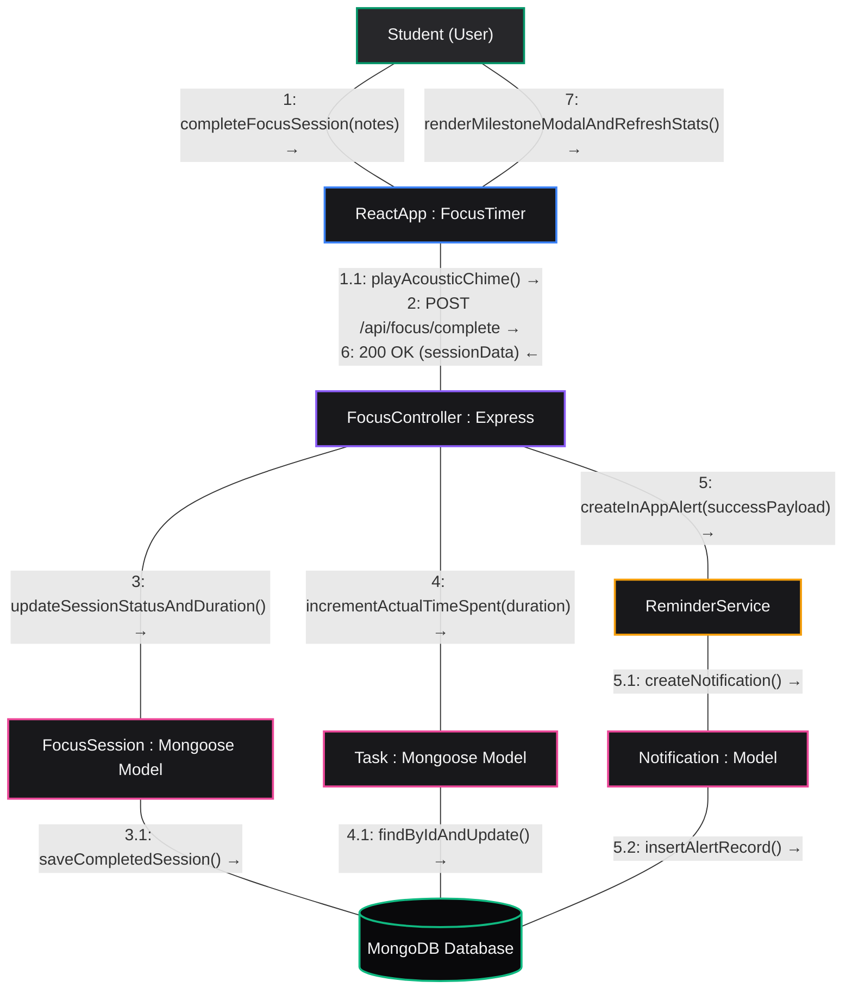

# UML Sequence Diagram & Communication (Collaboration) Diagram Specification
## SmartTask — Intelligent Academic Task & Schedule Planner (MERN Architecture)

---

## 1. Executive Summary & Architectural Overview

The **SmartTask System** is a full-stack MERN (MongoDB, Express, React, Node.js) platform designed to solve student task overwhelm through pure algorithmic scheduling, deadline proximity heuristics, and deep work tracking. 

To model the dynamic interactions and structural collaborations of the system, this document provides formal UML specifications for two complementary behavioral diagrams from the **UML 2.5 standard**:
1. **UML Sequence Diagrams**: Emphasizing the **chronological sequence** of message exchanges across lifelines over time.
2. **UML Communication (formerly Collaboration) Diagrams**: Emphasizing the **structural relationships and object links** through which numbered messages pass.

Both diagram types describe the same underlying interactions (semantic isomorphism) but present them through complementary perspectives.

```
+---------------------------------------------------------------------------------------+
|                               SmartTask System Layers                                 |
+---------------------------------------------------------------------------------------+
|  [Presentation Layer]     React Client (Views, State Context, Vite, Axios)             |
|                                     │                                                 |
|  [API / Controller Layer] Express Routers & Controllers (Auth, Task, Schedule, Focus)  |
|                                     │                                                 |
|  [Domain / Engine Layer]  Algorithmic Services (TaskAnalyzer, Scheduler, Reminders)   |
|                                     │                                                 |
|  [Persistence Layer]      Mongoose ODM Schemas & MongoDB Database                     |
+---------------------------------------------------------------------------------------+
```

---

## 2. In-Depth Technical Details: Sequence Diagrams

### 2.1 Definition and Purpose
A **Sequence Diagram** is an interaction diagram that details how operations are carried out—what messages are sent and when. Sequence diagrams are organized according to time. The time sequence of messages is seen by reading down the page.

### 2.2 Key Elements and Notations
- **Actor**: An external entity (e.g., `Student`, `Administrator`) that interacts with the system.
- **Lifeline**: Represents an individual participant in the interaction, drawn as a vertical dashed line descending from a labeled rectangle (`Name : Class`).
- **Activation Bar (Focus of Control)**: A thin vertical rectangle superimposed on a lifeline indicating when an object is actively executing an operation or waiting for a sub-routine to return.
- **Messages**:
  - **Synchronous Call (`―>>`)**: The sender suspends execution and waits for the message to be processed and acknowledged.
  - **Asynchronous Message (`-―)`)**: The sender continues execution without waiting for a reply.
  - **Reply / Return Message (`-->>`)**: Returns execution control and optional data back to the caller.
  - **Self-Message**: An object calling one of its own internal methods.
- **Combined Fragments (Interaction Frames)**:
  - `opt` (Optional): Executes only if a boolean guard condition evaluates to true.
  - `alt` (Alternative): Branching logic analogous to `if-else`.
  - `loop` (Iteration): Repeated message execution over a collection or while a condition is satisfied.
  - `par` (Parallel): Concurrent executions occurring simultaneously.

---

## 3. In-Depth Technical Details: Communication (Collaboration) Diagrams

### 3.1 Definition and Purpose
A **Communication Diagram** (designated as *Collaboration Diagram* in UML 1.x and renamed in UML 2.x) is an interaction diagram that focuses on the **structural organization of objects** that send and receive messages. Rather than dedicating a distinct vertical lifeline to time, objects are arranged as nodes in a graph with connection links (associations) representing paths along which messages flow.

### 3.2 Key Elements and Notations
- **Objects / Roles**: Depicted as rectangular boxes with the syntax `instanceName : ClassName` or `:ClassName` for anonymous instances.
- **Association Links**: Solid lines connecting collaborating objects indicating a communication pathway (such as object reference, dependency, or network connection).
- **Numbered Messages with Direction Arrows**:
  - Messages are rendered adjacent to the association line with a directional arrow (`->` or `<-`).
  - **Nested Decimal Numbering Scheme**: Conveys chronological sequence and nested call depth:
    - Top-level message: `1: initiateAction()`
    - Sub-calls invoked during execution of 1: `1.1: validate()`, `1.2: calculate()`, `1.2.1: checkThreshold()`
    - Subsequent independent action: `2: returnStatus()`
  - **Return Values and Parameters**: Specified in the format `sequenceNumber: returnVar := methodName(arguments)`.

---

## 4. Comparative Matrix: Sequence vs. Communication Diagrams

| Feature / Dimension | UML Sequence Diagram | UML Communication Diagram |
|---|---|---|
| **Primary Focus** | Chronological ordering of events and message timing | Structural coupling, relationships, and object collaboration topology |
| **Time Representation** | Vertical axis running strictly downwards | Explicit nested sequence numbers (`1`, `1.1`, `1.2`, `2`, etc.) |
| **Object Layout** | Horizontally spaced lifelines along the top | Free-form spatial graph of interconnected object nodes |
| **Object Lifecycles** | Explicit creation (`<<create>>`) and destruction (`X`) points | Creation/destruction notated via message text or stereotype constraints |
| **Control Logic** | Clearly segmented via visual frames (`opt`, `alt`, `loop`, `par`) | Guard conditions and iteration prefixes (e.g. `1.1 [status=='active']: update()`) |
| **Space Scalability** | Consumes vertical space rapidly as steps increase | Consumes 2D space; compact for complex multi-object webs |
| **Optimal Use Case** | Validating specific use-case scenarios, API handshakes, and call stacks | Refactoring, analyzing object coupling, and architectural structural validation |

---

## 5. UML Sequence Diagrams for SmartTask

### 5.1 Sequence Diagram 1: Task Creation, Algorithmic Analysis & In-App Alert Triggering

This sequence captures the core workflow of creating a task. The `TaskAnalyzer` heuristic engine evaluates deadline proximity and effort to determine the dynamic **Smart Priority Score (0–160)** and **Eisenhower Matrix quadrant** prior to persistence, followed by the notification subsystem scheduling reminders.



---

### 5.2 Sequence Diagram 2: Automated Smart Schedule Generation (Time-Blocking Engine)

This sequence illustrates how the algorithmic **Scheduler Engine** packs uncompleted deliverables into cognitive focus blocks and break intervals based on user preferences.



---

### 5.3 Sequence Diagram 3: Deep Work / Pomodoro Focus Session Lifecycle & Task Time Logging



---

## 6. UML Communication (Collaboration) Diagrams for SmartTask

### 6.1 Communication Diagram 1: Task Management & Algorithmic Priority Assessment



---

### 6.2 Communication Diagram 2: Smart Daily Schedule Planner & Time-Blocking Engine



---

### 6.3 Communication Diagram 3: Deep Work Focus Session & Milestone Logging



---

## 7. Implementation Traceability Matrix

| UML Message Step | Operation / Endpoint | Source Code File Reference |
|---|---|---|
| **Task Creation API** | `POST /api/tasks` | `backend/routes/taskRoutes.js` |
| **Smart Priority Calculation** | `analyzeTask(taskData)` | `backend/services/taskAnalyzer.js` |
| **Task Document Insertion** | `Task.create(taskData)` | `backend/controllers/taskController.js (L28)` |
| **Deadline Proximity Alerts** | `syncInAppRemindersForStudent(id)` | `backend/services/reminderService.js (L50)` |
| **Daily Schedule API** | `POST /api/schedule/generate` | `backend/routes/scheduleRoutes.js` |
| **Time-Blocking Algorithm** | `generateSmartScheduleForStudent()` | `backend/services/schedulerService.js (L13)` |
| **Schedule Persistence** | `Schedule.findOneAndUpdate(..., { upsert: true })` | `backend/services/schedulerService.js (L114)` |
| **Focus Session Lifecycle** | `POST /api/focus/start` & `/complete` | `backend/controllers/focusController.js` |
| **Task Cumulative Hours** | `Task.findByIdAndUpdate({ $inc: { actualTimeSpent } })` | `backend/controllers/focusController.js (L38)` |
